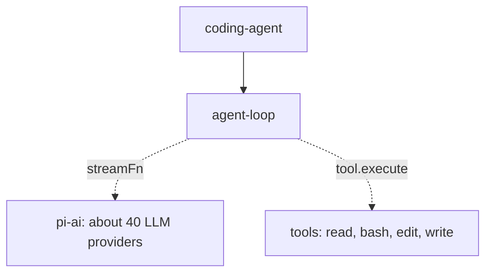
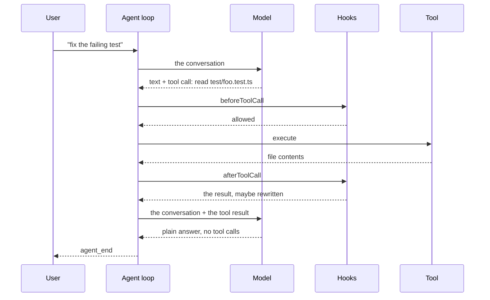
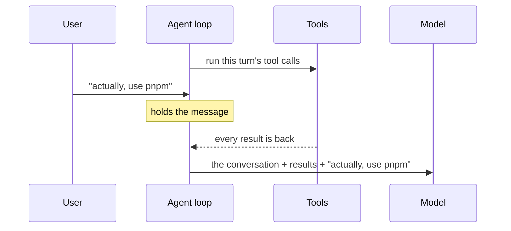
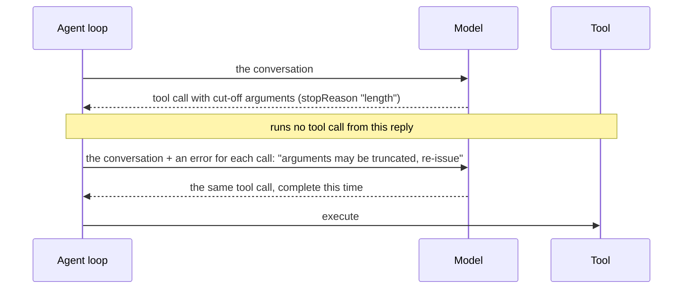

[Pi](https://pi.dev) is a small, hackable coding agent that runs in your terminal. You give it a task, it talks to an LLM, and the LLM uses tools like "read this file" or "run this command" until the task is done.

I've been reading Pi's code, and this is the first post in a series about how it works inside. I'm starting with the agent loop, because everything else in Pi hangs off it. Once you see how small and predictable it is, the rest of the design makes a lot more sense.

This post stays at a high level. If you want every detail, I also wrote [a reference page for the agent loop](/inside-pi/agent/agent-loop.html), with pseudocode for each function linked to the real code. Everything here is pinned to commit [`195120a`](https://github.com/earendil-works/pi/tree/195120a9156b79b0fab67d3a458b5315bed7a33f).

## Where the loop sits

The loop lives in `pi-agent-core`, in one file: `packages/agent/src/agent-loop.ts`. The coding agent calls into it. The loop calls out to the model through a function it's handed (`streamFn`), and to the tools through their `execute` functions. It never imports the coding agent, which is why it's easy to reuse.



What I like most is how little the loop does on its own. It keeps no state between runs. You hand it a conversation, a list of tools, and a config object full of optional hooks, and it reports everything it does as a stream of events.

All the clever parts of Pi (saving sessions, compaction, retries, plugins that block dangerous commands) live outside the loop and plug into those hooks. That keeps the loop easy to read and easy to trust. Later posts in this series look at those parts one by one.

## The loop in one picture

Two words come up a lot. A *turn* is one reply from the model, plus the tools it called and their results. A *run* is everything from one prompt until the loop stops, which can be many turns.

Stripped down to its shape, the loop looks like this:

```
loop:
    while the model keeps calling tools, or the user has typed something:
        send the conversation to the model
        if the reply is an error or was aborted: stop
        run the tool calls in the reply
        add their results to the conversation
    if a follow-up message is waiting: go around again
    stop
```

It's really two loops. The inner one runs while there is more work in the current exchange: tool calls to run, or messages the user typed in the meantime. The outer one checks for follow-up messages, which wait until the agent would otherwise stop.

The hooks sit at fixed points along the way. `beforeToolCall` can block a tool call, `afterToolCall` can rewrite its result, and `finishTurn` can end the run early or ask for one more request. The [reference page](/inside-pi/agent/agent-loop.html#runloop) has the full `runLoop`.

## Three runs, step by step

The picture above shows every path at once. To see how it plays out, here are three runs, shown as who talks to whom over time.

### One turn with a tool call

The model asks to read a file. The hooks get a say before and after the tool runs. When the model answers without a tool call, the run is over.



### The user types while the agent is working

Pi calls a message like this a *steering message*. The loop never interrupts a running tool. The new message waits until every tool call of the turn is done, then goes out with the next request.



### The model gets cut off

Sometimes the model runs out of output tokens in the middle of a reply that has tool calls. The arguments were rebuilt from cut-off JSON, so they might look fine and still be missing something. Pi runs none of the tool calls in that reply, and tells the model why.



Think about a `write` call whose file content got cut off halfway. The JSON can still parse after repair, and the tool could write half a file without any error. Refusing the whole reply costs one extra request, which is cheap compared to that.

## Details I liked

A few smaller choices stood out to me while reading the code.

**Parallel tools, in order.** Tools run in parallel by default, but `beforeToolCall` still sees the calls one by one, in the order the model asked. So a permission prompt never shows up out of order. The results also go back into the conversation in that order, even when the tools finish out of order. One exception: if any tool in the batch asks for `executionMode: "sequential"`, the whole batch runs one by one.

**No tool error escapes.** An unknown tool, bad arguments, a blocked call, a tool that throws, or a hook that throws: each one turns into an error result that the model can read and react to. The loop itself never throws because of a tool.

**A fresh API key for every request.** The loop asks `getApiKey` before each request, not once per run. OAuth tokens can expire during a long run, and this way the host can refresh them in time.

**The tool list lives in the conversation.** The loop doesn't keep the tool list as a separate field. It lives in system messages inside the conversation. Before each request, the loop compares the tools it can run with the tools the conversation has announced, and writes the difference into a system message. A saved conversation is then complete on its own: replay it, and you get exactly the same tools at every point.

## Go deeper

The [agent loop reference page](/inside-pi/agent/agent-loop.html) has the rest:

- the types and hooks the loop works with
- pseudocode for every function, each linked to its line in the repo
- the full list of rules the loop keeps on every run
- examples taken straight from Pi's test suite

It's part of [a small reference site](/inside-pi/) that will grow with this series.

Next, I'll look at the parts around the loop: the stateful `Agent` wrapper around the loop, how Pi's tools work, how sessions are saved on disk, and how context compaction keeps long conversations going.
