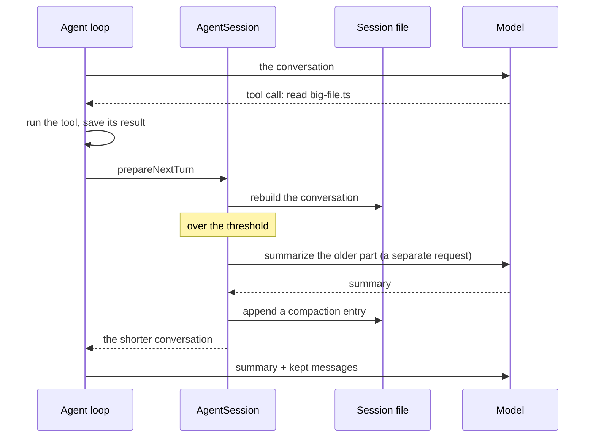
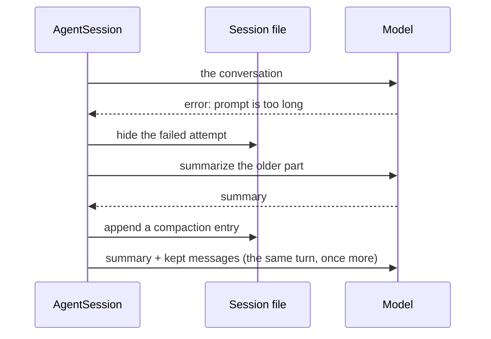

A coding agent reads a lot. Every file it opens and every command it runs ends up in the conversation, and the conversation goes to the model on every request. Sooner or later it no longer fits in the model's context window.

This is the second post in my series about how the [Pi](https://pi.dev) coding agent works inside. [The first post]() covered the agent loop. This one covers what Pi does when the context gets too big: it asks the model to summarize the older part of the conversation, and from then on sends the summary instead. Pi calls this *compaction*.

As before, this post stays at a high level. The details, with pseudocode linked to the real code, are on [the compaction reference page](/inside-pi/coding-agent/compaction.html). Everything is pinned to commit [`195120a`](https://github.com/earendil-works/pi/tree/195120a9156b79b0fab67d3a458b5315bed7a33f).

## A real example

Here is a short session. You ask Pi to fix a failing login test, then ask for one more test. Pi saves every message and every tool result as one *entry* in the session file.

To keep the numbers small, pretend the model has a 64,000-token context window. Pi keeps 16,384 tokens free for the model's reply, so the limit for the conversation is 64,000 - 16,384 = 47,616 tokens. The token counts are rough sizes, and the last column is the size of the whole conversation after each entry (leaving out the system prompt).

| # | Entry | Tokens | Total |
|---|---|---|---|
| 1 | **You:** "The login test fails. Find out why." | 20 | 20 |
| 2 | Pi calls `read src/auth/login.ts` | 30 | 50 |
| 3 | Tool result: the file, about 2,000 lines | 21,000 | 21,050 |
| 4 | Pi calls `bash npm test -- login` | 30 | 21,080 |
| 5 | Tool result: the test output with stack traces | 6,200 | 27,280 |
| 6 | Pi: "The expiry check uses `<`, not `<=`." It calls `edit` | 300 | 27,580 |
| 7 | Tool result: the diff of the fix | 120 | 27,700 |
| 8 | **You:** "Great. Add a test for expired tokens." | 40 | 27,740 |
| 9 | Pi calls `read test/login.test.ts` | 30 | 27,770 |
| 10 | Tool result: the test file | 18,200 | 45,970 |
| 11 | Pi calls `edit` with the new test | 1,600 | 47,570 |
| 12 | Tool result: the diff of the new test | 80 | **47,650** |

Pi checks the total before each request to the model. After entry 10 the total is 45,970, still under 47,616, so Pi sends the request and the model replies with entry 11. After entry 12 the total is 47,650, over the limit. So before Pi asks the model what to do next, it compacts. It does three things.

**1. Find the cut.** Pi keeps the newest 20,000 tokens or so word for word. To find where the kept part starts, it walks back from the newest entry and adds up sizes. This table shows the same entries in the same order as in the context. Read the last column from the bottom up, starting at entry 12 (↑):

<table>
  <thead>
    <tr><th>#</th><th>Entry</th><th>Tokens</th><th>Sum from the end</th></tr>
  </thead>
  <tbody>
    <tr class="ex-sum"><td>1</td><td><strong>You:</strong> “The login test fails. Find out why.”</td><td>20</td><td></td></tr>
    <tr class="ex-sum"><td>2</td><td>Pi calls <code class="language-plaintext highlighter-rouge">read src/auth/login.ts</code></td><td>30</td><td></td></tr>
    <tr class="ex-sum"><td>3</td><td>Tool result: the file, about 2,000 lines</td><td>21,000</td><td></td></tr>
    <tr class="ex-sum"><td>4</td><td>Pi calls <code class="language-plaintext highlighter-rouge">bash npm test -- login</code></td><td>30</td><td></td></tr>
    <tr class="ex-sum"><td>5</td><td>Tool result: the test output with stack traces</td><td>6,200</td><td></td></tr>
    <tr class="ex-sum"><td>6</td><td>Pi: “The expiry check uses <code class="language-plaintext highlighter-rouge">&lt;</code>, not <code class="language-plaintext highlighter-rouge">&lt;=</code>.” It calls <code class="language-plaintext highlighter-rouge">edit</code></td><td>300</td><td></td></tr>
    <tr class="ex-cross"><td>7</td><td>Tool result: the diff of the fix</td><td>120</td><td>20,070 (over)</td></tr>
    <tr class="ex-keep"><td>8</td><td>✂ <strong>You:</strong> “Great. Add a test for expired tokens.”</td><td>40</td><td>19,950</td></tr>
    <tr class="ex-keep"><td>9</td><td>Pi calls <code class="language-plaintext highlighter-rouge">read test/login.test.ts</code></td><td>30</td><td>19,910</td></tr>
    <tr class="ex-keep"><td>10</td><td>Tool result: the test file</td><td>18,200</td><td>19,880</td></tr>
    <tr class="ex-keep"><td>11</td><td>Pi calls <code class="language-plaintext highlighter-rouge">edit</code> with the new test</td><td>1,600</td><td>1,680</td></tr>
    <tr class="ex-keep"><td>12</td><td>Tool result: the diff of the new test</td><td>80</td><td>80 ↑</td></tr>
  </tbody>
</table>

<style>
  tr.ex-sum { background: rgba(128, 128, 128, 0.14) !important; }
  tr.ex-cross { background: rgba(230, 160, 20, 0.28) !important; }
  tr.ex-keep { background: rgba(46, 160, 67, 0.2) !important; }
</style>

Entries 12 back to 8 (green) come to 19,950, still under 20,000. Entry 7 (yellow) pushes the sum to 20,070, so the walk stops there and never reaches entries 1 to 6. But entry 7 is a tool result, and a tool result must stay right after the tool call that asked for it, so Pi can't cut there. It moves forward to the nearest entry where a cut is allowed: entry 8, your second message (✂). Entries 8 to 12 are kept. Entry 7 and everything before it (yellow and gray) get summarized.

**2. Summarize the old part.** Entries 1 to 7, 27,700 tokens, go to the model in a separate request, with instructions to write a summary. You'll see the summary [further down](#what-the-summary-looks-like).

**3. Add one entry.** Pi appends entry 13 to the session file:

```
13  compaction   summary: "## Goal\nFix the failing login test. ..."
                 firstKeptEntryId: 8        (where the kept part starts)
                 tokensBefore: 47650
```

Entries 1 to 7 are still in the file. Nothing is deleted. But before every request, Pi rebuilds the conversation from the file. When it finds a compaction entry, it starts with the summary, then jumps to `firstKeptEntryId` and adds the entries from there on. Say the summary is 400 tokens. This is what the model gets on the next request, in order:

<table>
  <thead>
    <tr><th>From</th><th>Role</th><th>Content</th><th>Tokens</th><th>Total</th></tr>
  </thead>
  <tbody>
    <tr><td></td><td>system</td><td>the system prompt</td><td></td><td></td></tr>
    <tr class="ex-new"><td>13</td><td>user</td><td>the summary, in <code class="language-plaintext highlighter-rouge">&lt;summary&gt;</code> tags (new)</td><td>400</td><td>400</td></tr>
    <tr class="ex-keep"><td>8</td><td>user</td><td>“Great. Add a test for expired tokens.”</td><td>40</td><td>440</td></tr>
    <tr class="ex-keep"><td>9</td><td>assistant</td><td>calls <code class="language-plaintext highlighter-rouge">read test/login.test.ts</code></td><td>30</td><td>470</td></tr>
    <tr class="ex-keep"><td>10</td><td>toolResult</td><td>the test file</td><td>18,200</td><td>18,670</td></tr>
    <tr class="ex-keep"><td>11</td><td>assistant</td><td>calls <code class="language-plaintext highlighter-rouge">edit</code> with the new test</td><td>1,600</td><td>20,270</td></tr>
    <tr class="ex-keep"><td>12</td><td>toolResult</td><td>the diff of the new test</td><td>80</td><td><strong>20,350</strong></td></tr>
  </tbody>
</table>

<style>
  tr.ex-new { background: rgba(56, 132, 255, 0.2) !important; }
</style>

The blue row is the new compaction entry. The green rows are the kept entries from step 1, unchanged. Entries 1 to 7 are not sent at all. Pi's next reply, and anything else added after entry 13, goes at the end of this list.

The summary goes in as a plain `user` message. It starts with the line "The conversation history before this point was compacted into the following summary:", and then the summary inside `<summary>` tags. Entries 8 to 12 go in exactly as they were. So 27,700 tokens of old work become 400, and the conversation drops from 47,650 to 20,350 tokens. The model still sees your latest request and everything it led to, and there is room again for about 27,000 more tokens before the next compaction.

Because nothing is deleted, the full history is still there for exports, for going back in the session tree, and for any tool that wants to look at it.

## When Pi compacts

The rule fits in a few lines. This is `shouldCompact`, as pseudocode:

```
function shouldCompact(contextTokens, contextWindow, settings):
    if not settings.enabled:
        return false
    limit = contextWindow - settings.reserveTokens   // 64,000 - 16,384
    return contextTokens > limit                     // 47,650 > 47,616
```

The comments show the numbers from the example above.

`reserveTokens` is room kept free for the model's reply, 16,384 tokens by default. The example used a made-up 64,000-token window. With a real 200,000-token model, Pi compacts once the context passes 183,616 tokens. Pi gets the context size from the token count the provider reported for the last reply, and estimates anything added since at about 4 characters per token.

Pi checks at three points: between turns in the middle of a run, after a run ends, and before it sends a new prompt. You can also run `/compact` yourself, with optional instructions for what the summary should focus on.

The between-turns check is the interesting one. It uses the agent loop's `prepareNextTurn` hook, which runs at the start of every turn after the first. The [agent loop reference page](/inside-pi/agent/agent-loop.html#applynextturnupdate) calls it "the host's chance to swap in a new conversation (say, after compacting old history)", and this is exactly that. A single `read` of a big file can push the context over the limit in the middle of a task, and this is where Pi catches it, before the next request goes out.



The loop itself knows nothing about compaction. It calls a hook and gets back a shorter conversation. If the user typed something while the summary was being written, it still goes out with the next request, the same way it does in any other turn.

### When the model is already over the limit

Sometimes the check comes too late: the provider rejects the request because the context is too long, or the reply gets cut off early because there is no room left. In that case Pi hides the failed attempt from the conversation, compacts, and runs the turn again.



It does this only once. If the retry also overflows, Pi stops and tells you to reduce the context or switch to a model with a bigger window. And if the reply finished normally but the context is now over the limit, Pi compacts without retrying, because the answer is already complete.

## Where to cut

The example above showed the basic rule: walk back from the newest entry until about 20,000 tokens (`keepRecentTokens`), and never cut at a tool result. In that example the cut landed on one of your messages, which is the easy case. Here's the hard one.

The session goes on. Entry 13 is the compaction from before, so the conversation starts again at 20,350 tokens. Then you ask for something bigger:

<table>
  <thead>
    <tr><th>#</th><th>Entry</th><th>Tokens</th><th>Total</th><th>Goes to</th></tr>
  </thead>
  <tbody>
    <tr class="ex-sum"><td>8–12</td><td>Kept last time: the new test</td><td>19,950</td><td></td><td>history summary</td></tr>
    <tr class="ex-sum"><td>13</td><td>The first summary</td><td>400</td><td>20,350</td><td>updated summary</td></tr>
    <tr class="ex-sum"><td>14</td><td><strong>You:</strong> “Now split src/auth into modules.”</td><td>30</td><td>20,380</td><td>request summary</td></tr>
    <tr class="ex-cross"><td>15–16</td><td><code class="language-plaintext highlighter-rouge">read src/auth/login.ts</code> + result</td><td>9,030</td><td>29,410</td><td>request summary</td></tr>
    <tr class="ex-keep"><td>17–18</td><td>✂ <code class="language-plaintext highlighter-rouge">read src/auth/session.ts</code> + result</td><td>7,030</td><td>36,440</td><td>kept</td></tr>
    <tr class="ex-keep"><td>19–20</td><td><code class="language-plaintext highlighter-rouge">read src/auth/tokens.ts</code> + result</td><td>6,030</td><td>42,470</td><td>kept</td></tr>
    <tr class="ex-keep"><td>21–22</td><td><code class="language-plaintext highlighter-rouge">write src/auth/expiry.ts</code> + result</td><td>2,540</td><td>45,010</td><td>kept</td></tr>
    <tr class="ex-keep"><td>23–24</td><td><code class="language-plaintext highlighter-rouge">edit src/auth/login.ts</code> + result</td><td>2,700</td><td><strong>47,710</strong></td><td>kept</td></tr>
  </tbody>
</table>

The colors mean the same as in the first example: green is kept word for word, starting at the cut (✂), yellow is where the walk back passes 20,000, and gray is summarized.

After entry 24 the total is 47,710, over the 47,616 limit again, so Pi compacts a second time.

Walking back from entry 24, the last four rows add up to 18,300. The `login.ts` read adds 9,000 more and passes 20,000 at entry 16, a tool result. The nearest allowed cut after it is entry 17, Pi's call to read `session.ts`.

That cut is in the middle of your request at entry 14. If Pi simply summarized everything before entry 17 into the history, the kept part would start with "read session.ts" and the model would have to dig your actual request out of a long summary. So Pi writes two summaries instead:

- **A history summary** of entries 8 to 12. Pi passes the first summary along and asks the model to update it rather than start over.
- **A request summary** of entries 14 to 16: what you asked for, the progress so far, and what's needed to continue.

Pi joins them into one summary, with the request summary at the end under the heading "Turn Context (split turn)". The compaction code calls a user request and everything after it a "turn", which is why it's a *split turn*. (It's a different meaning from a turn in the agent loop, which is one model reply.)

Pi saves it as entry 25, with `firstKeptEntryId: 17`. Say the joined summary is 700 tokens. This is what the model gets on the next request, in order:

<table>
  <thead>
    <tr><th>From</th><th>Role</th><th>Content</th><th>Tokens</th><th>Total</th></tr>
  </thead>
  <tbody>
    <tr><td></td><td>system</td><td>the system prompt</td><td></td><td></td></tr>
    <tr class="ex-new"><td>25</td><td>user</td><td>history summary + request summary (new)</td><td>700</td><td>700</td></tr>
    <tr class="ex-keep"><td>17</td><td>assistant</td><td>calls <code class="language-plaintext highlighter-rouge">read src/auth/session.ts</code></td><td>30</td><td>730</td></tr>
    <tr class="ex-keep"><td>18</td><td>toolResult</td><td>the file</td><td>7,000</td><td>7,730</td></tr>
    <tr class="ex-keep"><td>19</td><td>assistant</td><td>calls <code class="language-plaintext highlighter-rouge">read src/auth/tokens.ts</code></td><td>30</td><td>7,760</td></tr>
    <tr class="ex-keep"><td>20</td><td>toolResult</td><td>the file</td><td>6,000</td><td>13,760</td></tr>
    <tr class="ex-keep"><td>21</td><td>assistant</td><td>calls <code class="language-plaintext highlighter-rouge">write src/auth/expiry.ts</code></td><td>2,500</td><td>16,260</td></tr>
    <tr class="ex-keep"><td>22</td><td>toolResult</td><td>“Successfully wrote to src/auth/expiry.ts”</td><td>40</td><td>16,300</td></tr>
    <tr class="ex-keep"><td>23</td><td>assistant</td><td>calls <code class="language-plaintext highlighter-rouge">edit src/auth/login.ts</code></td><td>2,650</td><td>18,950</td></tr>
    <tr class="ex-keep"><td>24</td><td>toolResult</td><td>the diff</td><td>50</td><td><strong>19,000</strong></td></tr>
  </tbody>
</table>

As before, the blue row is the new compaction entry and the green rows are kept word for word. The context drops from 47,710 to 19,000 tokens. Your request at entry 14 is no longer in the list as a message. The model learns about it from the request summary, which sits at the end of the summary, right before the kept entries that continue that request.

Notice one more thing: entries 8 to 12 were kept word for word last time, and now they get summarized. Kept messages aren't kept forever. Once the newest 20,000 tokens move past them, they're folded into the summary.

## What the summary looks like

Pi asks the model for a fixed format. For the first compaction in the example, the summary could look like this. The section headings are the ones Pi's prompt asks for; the content is made up for this post:

```markdown
## Goal
Fix the failing login test.

## Constraints & Preferences
- (none)

## Progress
### Done
- [x] Ran `npm test -- login`: "rejects expired token" failed
- [x] Found the bug in `src/auth/login.ts`: the expiry check used `<`,
  not `<=`
- [x] Fixed the check

### In Progress
- [ ] (none)

### Blocked
- (none)

## Key Decisions
- **Fix the code, not the test**: the test matched the expected behavior

## Next Steps
1. Re-run the login tests

## Critical Context
- (none)

<modified-files>
src/auth/login.ts
</modified-files>
```

The file list at the end doesn't come from the model. Pi builds it from the `read`, `write`, and `edit` tool calls in the summarized entries. `src/auth/login.ts` was read at entry 2 and edited at entry 6, so it is listed only as modified. A file that was only read would go in a separate `<read-files>` list.

At the second compaction, Pi gives the model this summary plus entries 8 to 12, and asks it to update the summary: keep what's there, add what's new, and move finished items from "In Progress" to "Done". The file lists carry forward too. The second summary would list both `src/auth/login.ts`, carried over from the first one, and `test/login.test.ts`, edited at entry 11.

## How Pi keeps the summary request small and safe

**The conversation goes in as text, not as chat.** Pi turns the messages into a transcript like `[User]: ...` and `[Assistant tool calls]: read(path="a.ts")`, and sends it inside a single user message. If you send a model a chat history, it tends to continue the chat. A transcript, plus an instruction to "ONLY output the structured summary", gets a summary instead.

**Tool results are cut to 2,000 characters.** Most of a session's size comes from tool output, especially `read` and `bash`. The summarizer needs to know what happened, not every line of a file, so each tool result is shortened to its first 2,000 characters with a note saying how much was dropped.

**Thinking is left out.** A model's reasoning is often not part of its live context anyway, and including it could make the summary request bigger than the context it is meant to shrink.

**A cut-off summary is never saved.** If the summary reply stops because it hit its output limit, Pi throws it away instead of saving half a summary as the new starting point. It also rejects a summary that tries to call a tool.

**No prompt cache for summaries.** A summary request is a one-off, so Pi turns off prompt-cache writes for it instead of paying for a cache entry nobody will use.

**Extensions can take over.** A plugin can listen for `session_before_compact` and cancel the compaction, or write the summary itself, for example with a cheaper model. Pi saves whatever it returns.

## Branch summaries: going back and trying again

Pi has a second kind of summary. It's for when you give up on an attempt and go back to an earlier point in the session.

Here is a new session. You ask Pi to make the login tests faster, and Pi tries mocking the database:

| # | Entry |
|---|---|
| 1 | **You:** "Make the login tests faster." |
| 2 | Pi calls `read test/login.test.ts` |
| 3 | Tool result: the test file |
| 4 | Pi calls `edit`: swap the real database for an in-memory mock |
| 5 | Tool result: the diff |
| 6 | Pi calls `bash npm test -- login` |
| 7 | Tool result: 12 tests fail, "mock has no transaction support" |
| 8 | Pi: "12 tests fail. The mock has no transaction support." |

The mock was a bad idea. You type `/tree`, which shows the session as a tree, and pick entry 1 to start over from there. Pi asks "Summarize branch?" with three choices: "No summary", "Summarize", and "Summarize with custom prompt". You pick "Summarize".

Since entry 1 is your own message, Pi moves you to just before it and puts its text back in the editor, so you can change it and send it again. Pi also summarizes the part you are leaving, entries 2 to 8, and saves the summary as entry 9. Then you send the edited request, which becomes entry 10. Nothing is deleted. The session file now holds a tree with two branches:

```
(start)
 ├─ 1  You: "Make the login tests faster."        old branch
 │   └─ 2 to 8: mock the database, 12 tests fail
 └─ 9  summary of entries 2 to 8                  new branch
     └─ 10 You: "Make the login tests faster. Don't mock the DB."
```

On the new branch, the model gets this:

<table>
  <thead>
    <tr><th>From</th><th>Role</th><th>Content</th></tr>
  </thead>
  <tbody>
    <tr><td></td><td>system</td><td>the system prompt</td></tr>
    <tr class="ex-new"><td>9</td><td>user</td><td>the branch summary, in <code class="language-plaintext highlighter-rouge">&lt;summary&gt;</code> tags (new)</td></tr>
    <tr class="ex-keep"><td>10</td><td>user</td><td>“Make the login tests faster. Don't mock the DB.”</td></tr>
  </tbody>
</table>

The model never sees entries 1 to 8, but the summary tells it what was tried and why it failed. The summary message starts with "The following is a summary of a branch that this conversation came back from:". Inside the tags, the summary could look like this (made up for this post):

```markdown
The user explored a different conversation branch before returning here.
Summary of that exploration:

## Goal
Make the login tests faster.

## Progress
### Done
- [x] Replaced the real database with an in-memory mock in
  `test/login.test.ts`

### Blocked
- 12 login tests fail: "mock has no transaction support"

## Key Decisions
- **Mock the database**: tried first, did not work

...

<modified-files>
test/login.test.ts
</modified-files>
```

Branch summaries reuse a lot from compaction: the same transcript format, the same file lists, and almost the same summary headings. The differences:

- **You decide.** Compaction runs on its own. A branch summary is made only when you pick "Summarize" (a setting can turn off the question, and then Pi never summarizes).
- **It skips tool results.** Pi sends your messages, Pi's replies, and the tool calls, but not the tool results. The code's comment: the context is in the assistant's tool call. In the example, the summarizer sees `edit` and `bash npm test -- login`, but not the test file or the test output. It still knows about the error because Pi's reply at entry 8 mentions it.
- **A different budget.** Pi reads the abandoned branch from the newest entry back, and stops when the next entry would not fit in the context window minus 16,384 tokens. With the 64,000-token model from the first example, that's 47,616 tokens. One exception: if the entry that doesn't fit is an older summary (from a compaction or an earlier branch summary), Pi adds it anyway as long as less than 90% of the budget (42,854 tokens) is used. The code calls it "important context".

## Go deeper

The [compaction reference page](/inside-pi/coding-agent/compaction.html) has the rest:

- all four ways compaction starts, and how each one decides
- pseudocode for planning the cut, writing the summary, and rebuilding the conversation, each linked to its line in the repo
- the rules compaction keeps, and examples taken from Pi's tests

It's part of the [Inside Pi reference site](/inside-pi/), next to the agent loop.

Next, I'll look at the session file itself: how Pi stores a conversation as a tree of entries in a JSONL file, and how it turns that tree back into the conversation the model sees.
