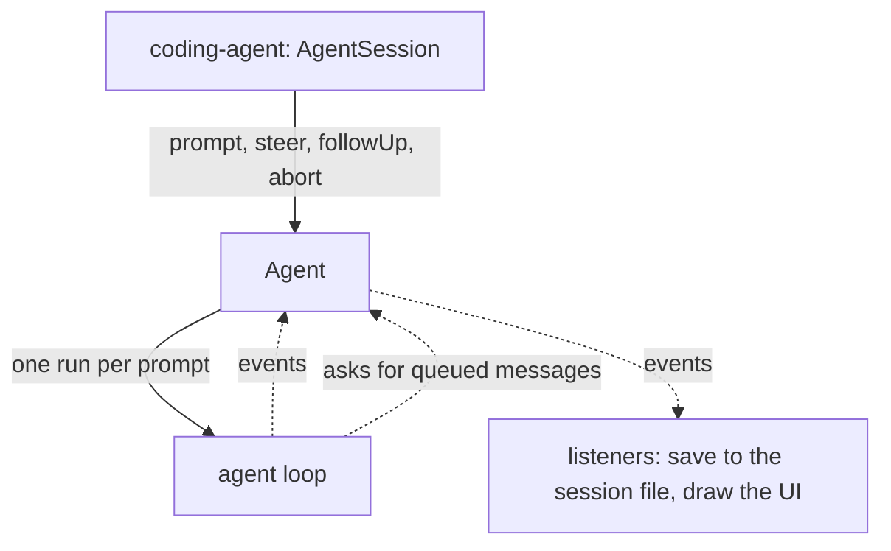
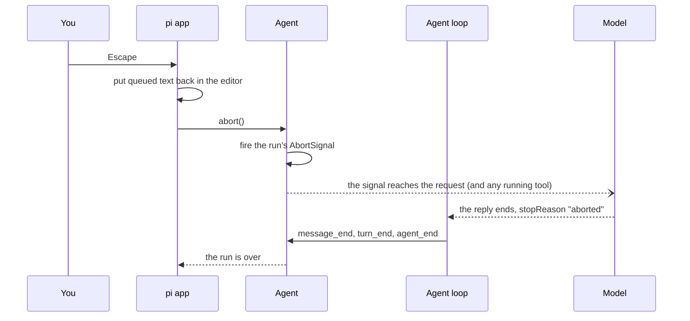

[The first post in this series]() was about the agent loop, and one thing I liked about it was that it keeps no state between runs. You hand it a conversation, it works, it returns. But a coding agent has to remember things: the conversation so far, the messages you typed while it was busy, and whether you pressed Escape.

In [Pi](https://pi.dev), that memory lives in one class, `Agent`, in `packages/agent/src/agent.ts`. This post looks at what it holds, what happens to a message you type while Pi is working, how stopping a run works, and why the app and the loop each get their own copy of the conversation.

As before, this post stays at a high level. The details, with pseudocode linked to the real code, are on [the agent reference page](/inside-pi/agent/agent.html). Everything is pinned to commit [`195120a`](https://github.com/earendil-works/pi/tree/195120a9156b79b0fab67d3a458b5315bed7a33f).

## Where the Agent sits

Pi's code is split into layers, each one a package that the next one builds on:

- **pi-ai** (`packages/ai`) talks to about 40 model providers through one API.
- **pi-agent-core** (`packages/agent`) holds the agent loop and the `Agent` class. It's a library: it knows nothing about terminals, files, or sessions, and other apps can use it too.
- **The coding agent** (`packages/coding-agent`, published as `pi-coding-agent`) is the `pi` app itself. It adds the tools (`read`, `edit`, `write`, `bash`), the session files, compaction, settings, and extensions. Its terminal UI, and its RPC and JSON modes, are thin layers on top.

Inside the coding agent, the central class is `AgentSession`. There is one for each open session, which means one session file. It lives from the moment you open or resume a session until you quit or switch to another one, across every prompt you send in between. When you switch with `/new` or `/resume`, Pi throws the old `AgentSession` away and creates a new one. Each `AgentSession` owns one `Agent`. It sends your prompts to it, saves what comes back to the session file, and decides when to compact. So `AgentSession` is not a turn or a list of messages. It's the object that runs one whole session.

The coding agent never calls the loop directly. It talks to an `Agent`, and the `Agent` starts one run of the loop for each prompt. The loop reports everything it does as events. The `Agent` updates its state from them, then passes them on to whoever subscribed.



The `Agent` holds four things:

- **The state.** The conversation (`messages`), the tools, the model, and the thinking level. Plus a few fields for the UI: whether a run is going, the reply that is streaming in, the tool calls still running, and the last error.
- **Two queues.** One for steering messages and one for follow-up messages.
- **An abort switch.** Each run gets its own `AbortController`.
- **Listeners.** The functions passed to `subscribe`.

Only one run can go at a time. If you call `prompt()` during a run, it throws:

```
Agent is already processing a prompt. Use steer() or followUp() to queue
messages, or wait for completion.
```

That message sums up the design. While a run is going, anything new goes into a queue.

## How a queued message reaches the model

The loop never sees the queues. It sees two functions in the config the `Agent` builds for each run. Cut down, they look like this:

```
getSteeringMessages: () => steeringQueue.drain()
getFollowUpMessages: () => followUpQueue.drain()
```

The loop decides *when* to call them. It asks for steering messages after every turn, once the turn's tools have finished. It asks for follow-ups only when it would otherwise stop. ([The loop post](#the-user-types-while-the-agent-is-working) has a diagram of this.)

The `Agent` decides *how many* messages come out per call. That's the queue mode. Pi has one setting for each queue, and both settings take the same two options:

| Setting | Options | Default |
|---|---|---|
| `steeringMode` | `"one-at-a-time"` or `"all"` | `"one-at-a-time"` |
| `followUpMode` | `"one-at-a-time"` or `"all"` | `"one-at-a-time"` |

- **`one-at-a-time`:** each call takes only the oldest message. The rest wait for the next call.
- **`all`:** each call takes the whole queue at once.

The two settings are separate, so you can mix them, for example `all` for steering and `one-at-a-time` for follow-ups.

## A real example

You ask Pi "Fix the failing login test." Pi starts with `read src/auth/login.ts`. While the read is running, you type four more messages. In the `pi` terminal app, Enter while Pi is working queues a steering message, and Alt+Enter queues a follow-up:

- Enter: "Use pnpm, not npm."
- Enter: "Also check session.ts."
- Alt+Enter: "Then update the changelog."
- Alt+Enter: "Then run the full test suite."

Nothing interrupts the `read`. The messages wait in the queues until the turn's tools are done. Below is the same session twice, once with each mode. Each row is one point where Pi takes messages out of a queue. The queue columns show the queues just before that, and the highlighted column shows what Pi takes out and adds to the next request.

<style>
  td.ex-take { background: rgba(56, 132, 255, 0.2); }
</style>

### With `one-at-a-time` (the default)

<table>
  <thead>
    <tr><th>When</th><th>Steering</th><th>Follow-up</th><th>Taken out</th><th>Then the model</th></tr>
  </thead>
  <tbody>
    <tr><td>The read<br>ends</td><td>Use pnpm<br>Check session.ts</td><td>Update changelog<br>Run full suite</td><td class="ex-take">Use pnpm</td><td>runs <code class="language-plaintext highlighter-rouge">pnpm test</code></td></tr>
    <tr><td>The tests<br>end</td><td>Check session.ts</td><td>Update changelog<br>Run full suite</td><td class="ex-take">Check session.ts</td><td>reads session.ts,<br>fixes the bug</td></tr>
    <tr><td>Pi would<br>stop</td><td></td><td>Update changelog<br>Run full suite</td><td class="ex-take">Update changelog</td><td>edits the changelog</td></tr>
    <tr><td>Pi would<br>stop</td><td></td><td>Run full suite</td><td class="ex-take">Run full suite</td><td>runs all the tests</td></tr>
    <tr><td>Pi would<br>stop</td><td></td><td></td><td class="ex-take">(nothing)</td><td>the run ends</td></tr>
  </tbody>
</table>

Each message gets a request of its own, so the model reacts to them one by one. It runs `pnpm test` before it even knows about `session.ts`. Pi takes steering messages after every turn but follow-ups only when it would stop, so both steering messages go out before the first follow-up.

### With `all`

<table>
  <thead>
    <tr><th>When</th><th>Steering</th><th>Follow-up</th><th>Taken out</th><th>Then the model</th></tr>
  </thead>
  <tbody>
    <tr><td>The read<br>ends</td><td>Use pnpm<br>Check session.ts</td><td>Update changelog<br>Run full suite</td><td class="ex-take">Use pnpm<br>Check session.ts</td><td>runs <code class="language-plaintext highlighter-rouge">pnpm test</code>,<br>reads session.ts,<br>fixes the bug</td></tr>
    <tr><td>Pi would<br>stop</td><td></td><td>Update changelog<br>Run full suite</td><td class="ex-take">Update changelog<br>Run full suite</td><td>edits the changelog,<br>runs all the tests</td></tr>
    <tr><td>Pi would<br>stop</td><td></td><td></td><td class="ex-take">(nothing)</td><td>the run ends</td></tr>
  </tbody>
</table>

The model gets both steering messages in one request, so it can plan with both in mind. The same goes for the two follow-ups. Pi takes messages out three times instead of five.

There's one more case. Say you press Enter just as Pi finishes, after the loop asked for steering messages for the last time. The message is still in the queue when the run ends. The `Agent` keeps its queues when a run ends, so the coding agent sees there is something left and calls `continue()`. `continue()` sends the queued message as the start of a new run, and nothing you typed is lost.

## Stopping a run

Press Escape while Pi is working, and the `pi` app does two things:

1. It takes everything out of both queues and puts the text back in your editor, steering messages first, then follow-ups, with a blank line between them.
2. It calls `abort()`.

Say you press Escape in the example, right after typing the four messages. The editor then holds:

```
Use pnpm, not npm.

Also check session.ts.

Then update the changelog.

Then run the full test suite.
```

The first step belongs to the app. The `Agent` itself never clears its queues when a run stops. The app does it, so you can edit the text and send it again.

`abort()` itself is one line: it fires the current run's `AbortSignal`. Nothing stops at that moment. The same signal goes to the model request, to every tool, to every hook, and to every listener, and each one stops when it notices:



When the loop gets a reply that was aborted, it ends the run without looking at the queues. The cut-off reply is still saved in the conversation, marked as aborted.

## Listeners hold up the run, on purpose

Every event goes through one function in the `Agent`. It updates the state first, and then calls each listener in the order they subscribed. It waits for each listener to finish before it calls the next one. The loop waits for all of that before it goes on.

The coding agent uses this. Its listener writes each message to the session file when the message ends. Since the loop waits, the model's reply is on disk before any of its tool calls run. If Pi crashes in the middle of a tool, the session file still shows what the model asked for.

It also changes what "done" means. `prompt()` doesn't return, and `isStreaming` stays true, until every listener has finished with the last event, `agent_end`. When `prompt()` returns, the session file is up to date.

The cost is that a slow listener slows Pi down. That seems like the right trade for an app that has to save everything.

## Two copies of the conversation

When a run starts, the `Agent` gives the loop a copy of the conversation, never its own array. From then on there are two copies:

- **The loop's copy.** The loop works only from this one. It adds each new message as soon as it has it.
- **The `Agent`'s copy** (`agent.state.messages`). This is the one the app reads. The `Agent` adds a message only when it gets the `message_end` event for it.

Most of the time the two hold the same messages, a moment apart. They differ when something replaces the loop's whole conversation in the middle of a run. No event reports that, so the `Agent` can't follow along on its own. [Compaction]() is the main example.

Here is the session from the compaction post. Entries 1 to 12 are the login-test fix. After entry 12, the conversation is over the limit, so Pi compacts before the next request: a summary replaces entries 1 to 7, and entries 8 to 12 are kept. Each box below shows both copies at one moment. Each arrow says what triggered the next change, who made it, and how. The copy that changed is highlighted.

<style>
  .cv-state { border: 1px solid rgba(128,128,128,.45); border-radius: 8px; padding: .6em .8em; }
  .cv-title { font-weight: 600; margin-bottom: .45em; }
  .cv-copies { display: flex; flex-wrap: wrap; gap: .6em; }
  .cv-copy { flex: 1 1 260px; border: 1px solid rgba(128,128,128,.3); border-radius: 6px; padding: .4em .6em; }
  .cv-copy.cv-changed { background: rgba(230,160,20,.2); border: 2px solid rgba(230,160,20,.9); }
  .cv-name { font-size: .85em; opacity: .8; margin-bottom: .3em; }
  .cv-m { display: inline-block; min-width: 1.8em; text-align: center; margin: 0 .2em .2em 0; padding: 0 .35em;
          border-radius: 4px; background: rgba(128,128,128,.18); font-size: .9em; }
  .cv-m.cv-sum { background: rgba(56,132,255,.3); }
  .cv-m.cv-new { background: rgba(46,160,67,.35); }
  .cv-arrow { position: relative; margin: .3em 0 .9em 1.2em; padding: .5em 0 .5em 1.1em; border-left: 3px solid #d08a1e; }
  .cv-arrow::after { content: "▼"; position: absolute; left: -.62em; bottom: -.95em; color: #d08a1e; }
  .cv-arrow div { margin: .1em 0; }
  .cv-state + p { margin-top: 1.2em; }
</style>

<div class="cv-state">
  <div class="cv-title">Entry 12 has ended. Both copies are the same.</div>
  <div class="cv-copies">
    <div class="cv-copy"><div class="cv-name">Loop's copy</div><span class="cv-m">1–7</span><span class="cv-m">8</span><span class="cv-m">9</span><span class="cv-m">10</span><span class="cv-m">11</span><span class="cv-m">12</span></div>
    <div class="cv-copy"><div class="cv-name">Agent's copy (<code>state.messages</code>)</div><span class="cv-m">1–7</span><span class="cv-m">8</span><span class="cv-m">9</span><span class="cv-m">10</span><span class="cv-m">11</span><span class="cv-m">12</span></div>
  </div>
</div>
<div class="cv-arrow">
  <div><strong>Trigger:</strong> the loop calls <code>prepareNextTurn</code> before the next request, and the conversation is over the limit.</div>
  <div><strong>Who:</strong> the coding agent (<code>AgentSession</code>).</div>
  <div><strong>How:</strong> it saves the compaction entry, rebuilds the conversation from the session file, and assigns it to <code>agent.state.messages</code>. The <code>Agent</code> is not told. Its array is simply replaced.</div>
</div>
<div class="cv-state">
  <div class="cv-title">The copies differ.</div>
  <div class="cv-copies">
    <div class="cv-copy"><div class="cv-name">Loop's copy</div><span class="cv-m">1–7</span><span class="cv-m">8</span><span class="cv-m">9</span><span class="cv-m">10</span><span class="cv-m">11</span><span class="cv-m">12</span></div>
    <div class="cv-copy cv-changed"><div class="cv-name">Agent's copy (<code>state.messages</code>)</div><span class="cv-m cv-sum">summary</span><span class="cv-m">8</span><span class="cv-m">9</span><span class="cv-m">10</span><span class="cv-m">11</span><span class="cv-m">12</span></div>
  </div>
</div>
<div class="cv-arrow">
  <div><strong>Trigger:</strong> <code>prepareNextTurn</code> returns.</div>
  <div><strong>Who:</strong> the loop.</div>
  <div><strong>How:</strong> it puts the conversation that <code>prepareNextTurn</code> returned (the same rebuilt one) in place of its own copy.</div>
</div>
<div class="cv-state">
  <div class="cv-title">Both copies hold the short conversation.</div>
  <div class="cv-copies">
    <div class="cv-copy cv-changed"><div class="cv-name">Loop's copy</div><span class="cv-m cv-sum">summary</span><span class="cv-m">8</span><span class="cv-m">9</span><span class="cv-m">10</span><span class="cv-m">11</span><span class="cv-m">12</span></div>
    <div class="cv-copy"><div class="cv-name">Agent's copy (<code>state.messages</code>)</div><span class="cv-m cv-sum">summary</span><span class="cv-m">8</span><span class="cv-m">9</span><span class="cv-m">10</span><span class="cv-m">11</span><span class="cv-m">12</span></div>
  </div>
</div>
<div class="cv-arrow">
  <div><strong>Trigger:</strong> the loop sends the request, and the model's reply starts streaming in.</div>
  <div><strong>Who:</strong> the loop.</div>
  <div><strong>How:</strong> it adds the reply (entry 14) to its copy right away, and updates it as more text arrives.</div>
</div>
<div class="cv-state">
  <div class="cv-title">The reply is streaming. Only the loop has it.</div>
  <div class="cv-copies">
    <div class="cv-copy cv-changed"><div class="cv-name">Loop's copy</div><span class="cv-m cv-sum">summary</span><span class="cv-m">8</span><span class="cv-m">9</span><span class="cv-m">10</span><span class="cv-m">11</span><span class="cv-m">12</span><span class="cv-m cv-new">14</span></div>
    <div class="cv-copy"><div class="cv-name">Agent's copy (<code>state.messages</code>)</div><span class="cv-m cv-sum">summary</span><span class="cv-m">8</span><span class="cv-m">9</span><span class="cv-m">10</span><span class="cv-m">11</span><span class="cv-m">12</span></div>
  </div>
</div>
<div class="cv-arrow">
  <div><strong>Trigger:</strong> the reply ends, and the loop sends a <code>message_end</code> event.</div>
  <div><strong>Who:</strong> the <code>Agent</code>.</div>
  <div><strong>How:</strong> it adds the finished reply to <code>state.messages</code>, then passes the event to its listeners.</div>
</div>
<div class="cv-state">
  <div class="cv-title">Both copies are the same again.</div>
  <div class="cv-copies">
    <div class="cv-copy"><div class="cv-name">Loop's copy</div><span class="cv-m cv-sum">summary</span><span class="cv-m">8</span><span class="cv-m">9</span><span class="cv-m">10</span><span class="cv-m">11</span><span class="cv-m">12</span><span class="cv-m cv-new">14</span></div>
    <div class="cv-copy cv-changed"><div class="cv-name">Agent's copy (<code>state.messages</code>)</div><span class="cv-m cv-sum">summary</span><span class="cv-m">8</span><span class="cv-m">9</span><span class="cv-m">10</span><span class="cv-m">11</span><span class="cv-m">12</span><span class="cv-m cv-new">14</span></div>
  </div>
</div>

The first two arrows are the compaction. The coding agent changes the `Agent`'s copy first, and the loop changes its own copy second. In the gap between them, the copies differ, but the loop is waiting for `prepareNextTurn` to return, so nothing reads its copy and no harm is done. The last two arrows are what happens to every new message: the loop has it first, and the `Agent` gets it through an event.

Now think about an app that uses `Agent` without the first arrow. The loop compacts, but `state.messages` still holds entries 1 to 12 and keeps growing from there. The next `prompt()` copies `state.messages` into the next run, so the model would get all 12 entries again and the compaction would be lost. Pi doesn't rely on one place for this. It also rebuilds every request from the session file, in its `prepareRequest` hook.

The copies keep the two sides apart. The app can change `state.messages` without breaking a request that is in flight, and the loop can never change the app's state except through events.

## When something throws

The loop turns almost every failure into a message: a model error, an abort, a tool that throws. But something can still throw. For example, a provider function might throw instead of returning an error stream. Then the `Agent` writes a reply itself: an empty assistant message with `stopReason: "error"` and the error text. It sends the same events a normal failed turn would send.

One of Pi's tests checks exactly this. The provider throws "provider exploded", and a listener sees the normal events for a failed turn, ending with `agent_end`. The last message in the conversation is the made-up reply, and `state.errorMessage` is "provider exploded". The UI needs only one way to show an error, whatever caused it.

## Go deeper

The [agent reference page](/inside-pi/agent/agent.html) has the rest:

- the state, the options, and every public method
- pseudocode for starting a run, building the loop's config, and keeping the state, each linked to its line in the repo
- what `continue()` does when the conversation ends with a reply, and what `reset()` keeps
- the rules the `Agent` keeps, and examples taken from Pi's tests

It's part of the [Inside Pi reference site](/inside-pi/), next to the agent loop and compaction.

Next, I'll look at Pi's tools: how `read`, `edit`, `write`, and `bash` work, and why two writes to the same file wait for each other even when tools run in parallel.
