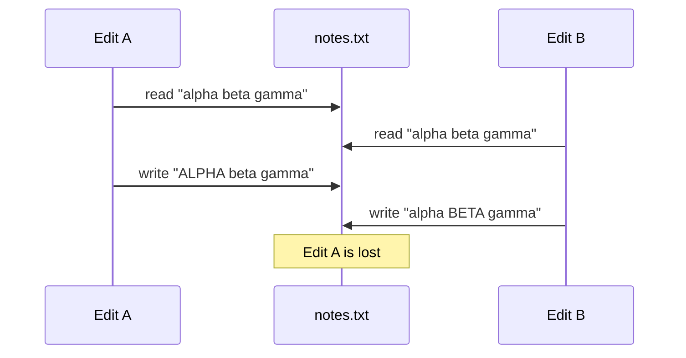
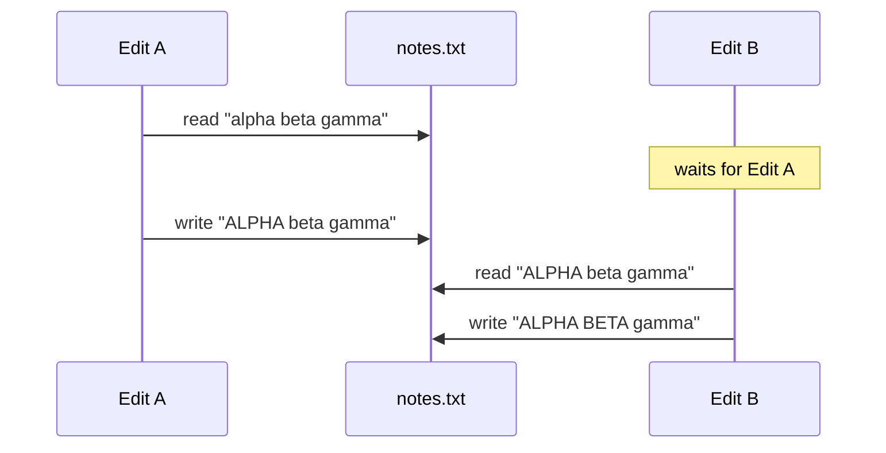

Tools are where a coding agent touches your machine. The model can only write text. It's the tools that read your files, change them, and run your commands.

This is the fourth post in my series about how the [Pi](https://pi.dev) coding agent works inside. [The first post]() showed how a tool call runs from the loop's side: check the arguments, ask the hooks, run the tool, add the result. This post opens the tools themselves. I'll look at four questions, each with a small example:

- What happens when a file or a command's output is too big?
- How does `edit` change a file without line numbers?
- What if two edits to the same file run at the same time?
- How does a tool call another tool?

As before, this post stays at a high level. The details, with pseudocode linked to the real code, are on [the tools reference page](/inside-pi/coding-agent/tools.html). Everything is pinned to commit [`195120a`](https://github.com/earendil-works/pi/tree/195120a9156b79b0fab67d3a458b5315bed7a33f).

## Four tools

By default, Pi gives the model four tools:

| Tool | What it does | Arguments |
|---|---|---|
| `read` | Reads a text file or an image | `path`, `offset`, `limit` |
| `write` | Creates or replaces a whole file | `path`, `content` |
| `edit` | Replaces exact pieces of text in a file | `path`, `edits` |
| `bash` | Runs a shell command | `command`, `timeout` |

There are also `grep`, `find`, `ls`, and `powershell`, but they are off unless you turn them on. Most of the time, `bash` can do their job.

Each tool is a name, a description, a JSON schema for its arguments, and an `execute` function. The description is written for the model, and it's honest about the limits. Here is `read`'s:

> Read the contents of a file. Supports text files and images (jpg, png, gif, webp, bmp). Images are sent as attachments. For text files, output is truncated to 2000 lines or 50KB (whichever is hit first). Use offset/limit for large files. When you need the full file, continue with offset until complete.

Tools also add short rules to the system prompt. `read` adds "Use read to examine files instead of cat or sed." `write` adds "Use write only for new files or complete rewrites."

One more design choice: every tool does its disk or process work through a small "operations" object. The default one uses your local disk and shell. Replace it, and the same `read` or `bash` works over SSH or inside a container.

## Too much output

A model's context has a limit, and one big file can fill much of it. So every text result from `read` and `bash` is cut at **2,000 lines or 50KB, whichever comes first**. The interesting part is which end gets kept:

| Tool | Keeps | Why |
|---|---|---|
| `read` | the start | you read a file from the top |
| `bash` | the end | errors and final results come last |

Cutting alone would leave the model guessing what it missed. So each cut result ends with a note that says exactly how to get the rest.

**Example 1: reading a long file.** Say the model reads a log file with 2,500 lines. It gets lines 1 to 2,000, and then:

> [Showing lines 1-2000 of 2500. Use offset=2001 to continue.]

The model calls `read` again with `offset: 2001` and gets the last 500 lines. (This is one of Pi's tests, with these exact numbers.)

**Example 2: a test run with lots of output.** Say `bash` runs `npm test`, and the tests print 3,000 lines. The model gets the last 2,000, where the failures and the summary are, and then:

> [Showing lines 1001-3000 of 3000. Full output: /tmp/pi-bash-1a2b3c4d5e6f7a8b.log]

Pi wrote the full output to that temp file while the command ran. If the model needs the start, it can `read` the file, or `grep` it with `bash`. The temp file is created only when the output passes a limit, and only you can read it. While the command runs, Pi keeps just the recent output in memory, so a command that prints gigabytes doesn't fill your RAM.

**Example 3: one giant line.** A minified JavaScript file can be a single line of 2MB. `read` never returns half a line, so it returns a hint instead:

> [Line 1 is 2.0MB, exceeds 50.0KB limit. Use bash: sed -n '1p' app.min.js | head -c 51200]

## Editing without line numbers

`edit` doesn't take line numbers or patches. The model sends the exact text to find, and the text to put in its place. Here is a fix to the login bug from [the compaction post]():

```json
{
  "path": "src/auth/login.ts",
  "edits": [
    {
      "oldText": "if (expiresAt < now)",
      "newText": "if (expiresAt <= now)"
    }
  ]
}
```

Line numbers go stale: after one change, every line below it moves. Exact text doesn't. But exact text has its own risks: it might not be there, or it might be there twice. So `edit` checks every edit before it writes anything. Here is what the model gets back for each problem:

- **`oldText` is not in the file:** "Could not find the exact text in src/auth/login.ts. The old text must match exactly including all whitespace and newlines."
- **`oldText` appears 3 times:** "Found 3 occurrences of the text in src/auth/login.ts. The text must be unique. Please provide more context to make it unique."
- **Two edits overlap:** "edits[0] and edits[1] overlap in src/auth/login.ts. Merge them into one edit or target disjoint regions."

Each error goes back to the model as the tool result, so it can fix its call and try again. The messages say what to do, not just what went wrong.

**All or nothing.** One call can hold several edits. If any of them fails, none is written. In one of Pi's tests, the file is `alpha / beta / gamma`. The call has two edits: `alpha` to `ALPHA`, and `missing` to `MISSING`. The second one fails, and the file stays exactly as it was. Half an edit is often worse than none, because the code would no longer match what the model thinks it wrote.

**Matched against the original.** Every `oldText` is looked up in the file as it was before the call, not after the earlier edits. Another test shows why this matters. The file is `foo / bar / baz`, and the edits are `foo` to `foo bar` and `bar` to `BAR`. If the edits ran one after another, the second could match the `bar` the first one just added. Matched against the original, the result is `foo bar / BAR / baz`, which is what the model meant.

**Close enough is fine, sometimes.** Models make small copying mistakes. If the exact text isn't found, `edit` tries again after making both sides plainer:

- spaces at the end of a line are ignored
- curly quotes (`“ ” ‘ ’`) count as straight quotes
- Unicode dashes (`– —`) count as `-`
- special spaces, like a non-breaking space, count as a normal space

So if your file says `msg = “Hello”` and the model sends `msg = "Hello"`, the edit still works. Only the lines the edit touches are rewritten. Every other line keeps its exact original bytes.

**The file keeps its format.** Windows line endings (`\r\n`) and an invisible byte-order mark at the start of the file both survive an edit. The model always works with plain `\n`, and Pi puts the original endings back when it writes.

After the write, Pi builds a diff of the change. You see it in the terminal. The model gets one line: "Successfully replaced 1 block(s) in src/auth/login.ts."

## Two edits to the same file

Pi runs the tool calls of one reply in parallel by default. That's great for reading three files at once. But think about two edits to the same file in one reply:

- Edit A: `alpha` to `ALPHA`
- Edit B: `beta` to `BETA`

Each edit reads the file, changes its own part, and writes the whole file back. If both run at once, this can happen:



Both edits say they succeeded, and one of them is gone. So Pi puts every `write` and `edit` through a queue for each file. A change to a file waits until the change before it is done:



Pi has a test for exactly this case, with a slow disk to make the race likely. The file must end up as `ALPHA / BETA / gamma`.

A few details make the queue reliable:

- **One queue per real file.** The queue is keyed by the file's real path. A symlink and its target share one queue.
- **Other files don't wait.** An edit to `login.ts` and an edit to `session.ts` still run at the same time.
- **Abort doesn't break it.** If you press Escape during a write, the tool keeps the file locked until the write has really finished. Only then can the next change start. The code says why: releasing early "would release the mutation queue while an in-flight filesystem operation may still finish."

## Running a command

`bash` is the simplest tool to describe and the hardest to get right. A few behaviors stand out:

- **You see output live.** While the command runs, the terminal shows the latest output, updated at most every 100ms.
- **A failing command is a normal result.** If a command exits with an error code, the model gets the output and a status line, marked as an error. For `echo out; exit 3` the model gets `out`, then `Command exited with code 3`. The output is kept, because it usually explains the failure.
- **No timeout unless asked.** The model can pass `timeout` in seconds. Without it, a command runs until it ends or you press Escape.
- **Stop means stop.** On Escape or a timeout, Pi kills the whole process tree, not just the shell. A dev server or a watcher that the command started stops too.
- **The command knows about Pi.** It runs with `PI_SESSION_ID`, `PI_SESSION_FILE`, `PI_MODEL`, and a few other variables set, so scripts can tell which session they run in.

## Tools that call tools

Some tools call other tools while they run. The main one is `codemode`: the model writes a small JavaScript program, and the program calls tools. Say the model wants the first lines of three config files. Instead of three tool calls and three results in the conversation, it sends one script:

```js
for (const path of ["tsconfig.json", "package.json", ".eslintrc.json"]) {
  const text = await tools.read({ path, limit: 5 });
  // ...collect what it needs
}
```

The script's three `read` calls are *nested* calls. They never enter the conversation. The model sees only what the script returns. That saves context, but it raises a question: do the safety checks still apply?

They do. Each nested call goes through the same pipeline as a call from the model, the loop's `runToolCall`. So `beforeToolCall`, where a plugin can block a dangerous command, sees nested calls too. A script can't get around a permission check by calling `bash` itself.

Nested calls are still recorded. If the `codemode` call has the id `call_7`, its nested calls get the ids `call_7/1`, `call_7/2`, and `call_7/3`. In the terminal, they show up inside the `codemode` call's row as they run. When the `codemode` result is saved, it carries a short record of the nested calls (name, arguments, status, and time) and their total token usage. And if the agent is set to run tools one at a time, nested calls wait their turn too.

## Go deeper

The [tools reference page](/inside-pi/coding-agent/tools.html) has the rest:

- the arguments of each tool and the shared limits
- pseudocode for `read`, `write`, `edit`, `bash`, the two truncation functions, the file queue, and nested calls, each linked to its line in the repo
- the rules the tools keep, and examples taken from Pi's tests

It's part of the [Inside Pi reference site](/inside-pi/), next to the agent loop, the Agent wrapper, and compaction.

Next, I'll look at sessions on disk: how Pi stores a conversation as a tree of entries in a JSONL file, and how it turns that tree back into the conversation the model sees.
