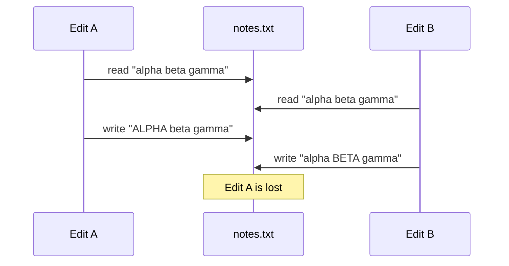
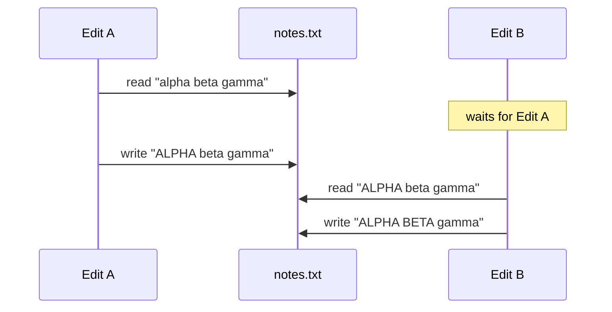
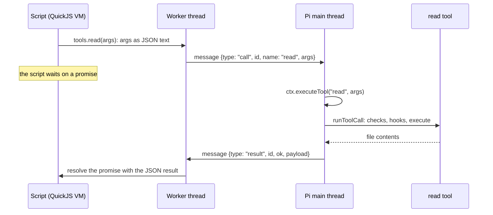

Tools are where a coding agent touches your machine. The model can only write text. It's the tools that read your files, change them, and run your commands.

This is the fourth post in my series about how the [Pi](https://pi.dev) coding agent works inside. [The first post]() showed how a tool call runs from the loop's side: check the arguments, ask the hooks, run the tool, add the result. This post opens the tools themselves. I'll look at four questions, each with a small example:

- What happens when a file or a command's output is too big?
- How does `edit` change a file without line numbers?
- What if two edits to the same file run at the same time?
- How does a tool call another tool?

As before, this post stays at a high level. The details, with pseudocode linked to the real code, are on [the tools reference page](/inside-pi/coding-agent/tools.html). Everything is pinned to commit [`195120a`](https://github.com/earendil-works/pi/tree/195120a9156b79b0fab67d3a458b5315bed7a33f).

## Four tools

By default, Pi gives the model four tools:

| Tool | What it does | Arguments |
|---|---|---|
| `read` | Reads a text file or an image | `path`, `offset`, `limit` |
| `write` | Creates or replaces a whole file | `path`, `content` |
| `edit` | Replaces exact pieces of text in a file | `path`, `edits` |
| `bash` | Runs a shell command | `command`, `timeout` |

There are also `grep`, `find`, `ls`, and `powershell`, but they are off unless you turn them on. Most of the time, `bash` can do their job.

Each tool is a name, a description, a JSON schema for its arguments, and an `execute` function. The description is written for the model, and it's honest about the limits. Here is `read`'s:

> Read the contents of a file. Supports text files and images (jpg, png, gif, webp, bmp). Images are sent as attachments. For text files, output is truncated to 2000 lines or 50KB (whichever is hit first). Use offset/limit for large files. When you need the full file, continue with offset until complete.

Tools also add short rules to the system prompt. `read` adds "Use read to examine files instead of cat or sed." `write` adds "Use write only for new files or complete rewrites."

One more design choice: every tool does its disk or process work through a small "operations" object. The default one uses your local disk and shell. Replace it, and the same `read` or `bash` works over SSH or inside a container.

## Too much output

A model's context has a limit, and one big file can fill much of it. So every text result from `read` and `bash` is cut at **2,000 lines or 50KB, whichever comes first**. The interesting part is which end gets kept:

| Tool | Keeps | Why |
|---|---|---|
| `read` | the start | you read a file from the top |
| `bash` | the end | errors and final results come last |

Cutting alone would leave the model guessing what it missed. So each cut result ends with a note that says exactly how to get the rest.

**Example 1: reading a long file.** Say the model reads a log file with 2,500 lines. It gets lines 1 to 2,000, and then:

> [Showing lines 1-2000 of 2500. Use offset=2001 to continue.]

The model calls `read` again with `offset: 2001` and gets the last 500 lines. (This is one of Pi's tests, with these exact numbers.)

**Example 2: a test run with lots of output.** Say `bash` runs `npm test`, and the tests print 3,000 lines. The model gets the last 2,000, where the failures and the summary are, and then:

> [Showing lines 1001-3000 of 3000. Full output: /tmp/pi-bash-1a2b3c4d5e6f7a8b.log]

Pi wrote the full output to that temp file while the command ran. If the model needs the start, it can `read` the file, or `grep` it with `bash`. The temp file is created only when the output passes a limit, and only you can read it. While the command runs, Pi keeps just the recent output in memory, so a command that prints gigabytes doesn't fill your RAM.

**Example 3: one giant line.** A minified JavaScript file can be a single line of 2MB. `read` never returns half a line, so it returns a hint instead:

> [Line 1 is 2.0MB, exceeds 50.0KB limit. Use bash: sed -n '1p' app.min.js | head -c 51200]

## Editing without line numbers

`edit` doesn't take line numbers or patches. The model sends the exact text to find, and the text to put in its place. Here is a fix to the login bug from [the compaction post]():

```json
{
  "path": "src/auth/login.ts",
  "edits": [
    {
      "oldText": "if (expiresAt < now)",
      "newText": "if (expiresAt <= now)"
    }
  ]
}
```

Line numbers go stale: after one change, every line below it moves. Exact text doesn't. But exact text has its own risks: it might not be there, or it might be there twice. So `edit` checks every edit before it writes anything. Here is what the model gets back for each problem:

- **`oldText` is not in the file:** "Could not find the exact text in src/auth/login.ts. The old text must match exactly including all whitespace and newlines."
- **`oldText` appears 3 times:** "Found 3 occurrences of the text in src/auth/login.ts. The text must be unique. Please provide more context to make it unique."
- **Two edits overlap:** "edits[0] and edits[1] overlap in src/auth/login.ts. Merge them into one edit or target disjoint regions."

Each error goes back to the model as the tool result, so it can fix its call and try again. The messages say what to do, not just what went wrong.

**All or nothing.** One call can hold several edits. If any of them fails, none is written. In one of Pi's tests, the file is `alpha / beta / gamma`. The call has two edits: `alpha` to `ALPHA`, and `missing` to `MISSING`. The second one fails, and the file stays exactly as it was. Half an edit is often worse than none, because the code would no longer match what the model thinks it wrote.

**Matched against the original.** Every `oldText` is looked up in the file as it was before the call, not after the earlier edits. Another test shows why this matters. The file is `foo / bar / baz`, and the edits are `foo` to `foo bar` and `bar` to `BAR`. If the edits ran one after another, the second could match the `bar` the first one just added. Matched against the original, the result is `foo bar / BAR / baz`, which is what the model meant.

**Close enough is fine, sometimes.** Models make small copying mistakes. If the exact text isn't found, `edit` tries again after making both sides plainer:

- spaces at the end of a line are ignored
- curly quotes (`“ ” ‘ ’`) count as straight quotes
- Unicode dashes (`– —`) count as `-`
- special spaces, like a non-breaking space, count as a normal space

So if your file says `msg = “Hello”` and the model sends `msg = "Hello"`, the edit still works. Only the lines the edit touches are rewritten. Every other line keeps its exact original bytes.

**The file keeps its format.** Windows line endings (`\r\n`) and an invisible byte-order mark at the start of the file both survive an edit. The model always works with plain `\n`, and Pi puts the original endings back when it writes.

After the write, Pi builds a diff of the change. You see it in the terminal. The model gets one line: "Successfully replaced 1 block(s) in src/auth/login.ts."

## Two edits to the same file

Pi runs the tool calls of one reply in parallel by default. That's great for reading three files at once. But think about two edits to the same file in one reply:

- Edit A: `alpha` to `ALPHA`
- Edit B: `beta` to `BETA`

Each edit reads the file, changes its own part, and writes the whole file back. If both run at once, this can happen:



Both edits say they succeeded, and one of them is gone. So Pi puts every `write` and `edit` through a queue for each file. A change to a file waits until the change before it is done:



Pi has a test for exactly this case, with a slow disk to make the race likely. The file must end up as `ALPHA / BETA / gamma`.

### What the lock covers

The lock has to cover more than the write. `edit` holds it for its whole read-modify-write: it checks that the file exists, reads it, applies the edits, and writes it back. That's why Edit B in the diagram reads `ALPHA beta gamma`. It can't even read the file until Edit A has written it. `write` holds the lock while it creates the parent folders and writes the file.

### How the queue works

The queue is one map for the whole Pi process, from a file's real path to a chain of promises. Each change to a file adds itself to the end of that file's chain, waits for the change before it, runs, and then lets the next one go:

```
withFileMutationQueue(path, fn):
    key  = realpath(path)             // a file that doesn't exist yet: its resolved path
    prev = queues[key], or "done" if there is none
    queues[key] = prev, then my turn
    await prev                        // wait for the change ahead of me
    try:     run fn                   // my read, change, and write
    finally: end my turn; if I was the last one, remove queues[key]
```

There's one subtle part. Finding the key needs `realpath()`, which is async. If two calls did that at the same moment, both could look in the map before either added itself. Both would find it empty, and both would run at once. The order could also flip, depending on which `realpath` returned first. So Pi runs this registration step one call at a time, through a second, global chain. As a result, a file's queue is in exactly the order in which the tools asked for it.

### Which change goes first

So what is "the order the tools asked"? For the calls in one reply, it's the order the model wrote them. The loop first checks every call one by one, in order. Then it starts them all at once with `Promise.all`, which starts them in array order. Nothing waits between a call starting and its tool reaching the queue. So the calls join each file's queue in reply order.

Say one reply has four calls:

```
1. edit  login.ts     2. edit  login.ts     3. write login.ts     4. edit session.ts
```

Calls 1, 2, and 3 run one after another on `login.ts`. Call 4 runs at the same time as them, because it's a different file. Call 2 sees call 1's change. Call 3 replaces the whole file, so it wipes out both edits. That may not be what the model meant, but the result is the same every time. It's an order, not a race.

The queue keeps changes apart. It doesn't make them agree. If call 1 changes text that call 2's `oldText` was looking for, call 2 fails with "Could not find edits[0]...". The model sees that error and can try again. Nothing is lost without a trace.

A few more details make the queue reliable:

- **One queue per real file.** The queue is keyed by the file's real path. A symlink and its target share one queue.
- **Other files don't wait.** An edit to `login.ts` and an edit to `session.ts` still run at the same time.
- **A failure doesn't block the file.** The turn ends in a `finally`, so if an edit throws, the next change still runs.
- **Abort doesn't break it.** If you press Escape during a write, the tool keeps the file locked until the write has really finished. Only then can the next change start. The tool doesn't reject from an abort listener. It checks the signal after each `await` instead. The code says why: releasing early "would release the mutation queue while an in-flight filesystem operation may still finish."

### What the queue doesn't cover

The queue only knows about Pi's own `write` and `edit`. These can still race with them:

- **`bash`.** A `sed -i` or `echo ... > file` doesn't go through the queue.
- **`read`.** Reads don't wait. A `read` in the same reply may see the file before or after an edit.
- **Anything outside this Pi process.** Another Pi instance, your editor, or a formatter that runs on save.
- **Hard links.** `realpath` follows symlinks, but two hard links to one file are two different paths. They get two queues.

One more caveat. "Reply order" depends on nothing waiting before the tool reaches the queue. That's true for the built-in tools. An extension that wraps `edit` and does some async work first could change the order.

## Running a command

`bash` is the simplest tool to describe and the hardest to get right. A few behaviors stand out:

- **You see output live.** While the command runs, the terminal shows the latest output, updated at most every 100ms.
- **A failing command is a normal result.** If a command exits with an error code, the model gets the output and a status line, marked as an error. For `echo out; exit 3` the model gets `out`, then `Command exited with code 3`. The output is kept, because it usually explains the failure.
- **No timeout unless asked.** The model can pass `timeout` in seconds. Without it, a command runs until it ends or you press Escape.
- **Stop means stop.** On Escape or a timeout, Pi kills the whole process tree, not just the shell. A dev server or a watcher that the command started stops too.
- **The command knows about Pi.** It runs with `PI_SESSION_ID`, `PI_SESSION_FILE`, `PI_MODEL`, and a few other variables set, so scripts can tell which session they run in.

## Tools that call tools

Some tools call other tools while they run. The main one is `codemode`: the model writes a small JavaScript program, and the program calls tools. Say the model wants the first lines of three config files. Instead of three tool calls and three results in the conversation, it sends one script:

```js
for (const path of ["tsconfig.json", "package.json", ".eslintrc.json"]) {
  const text = await tools.read({ path, limit: 5 });
  // ...collect what it needs
}
```

The script's three `read` calls are *nested* calls. They never enter the conversation. The model sees only what the script returns. That saves context, but it raises two questions. Who runs the script? And can the script do anything it likes on your machine?

### Who runs the script

Pi runs it itself. It doesn't save the script to a file, and it doesn't start `node` or `python` to run it. The script arrives as a string in the `codemode` call's arguments, and Pi hands that string straight to a sandbox.

The sandbox comes from Pi's `pi-codemode` package. It's built on QuickJS, a small JavaScript engine written in C. Pi uses a build of QuickJS compiled to WebAssembly (wasm), so the engine runs inside Pi's own Node or Bun process like any other wasm module. For each script, Pi does this:

1. It starts a new worker thread. A worker thread is a second JavaScript thread inside the same process, with its own event loop.
2. Inside that worker, it creates a fresh QuickJS VM. The VM is a separate wasm instance with its own memory.
3. It loads a short setup script, the *prelude*, into the VM. The prelude builds `tools`, `text`, `console`, and the other helpers the script can use.
4. It wraps the model's code in an `async` function and runs it. That's why `return` and top-level `await` work.
5. When the script finishes, fails, times out, or you press Escape, Pi terminates the worker. The VM goes with it.

Every run starts from nothing. A script can't leave a global variable or a patched built-in behind for the next one. The only thing that lasts between runs is `store(key, value)`. Pi saves it in the session file, not in the VM.

Why a separate thread? QuickJS runs synchronously. If it ran on Pi's main thread, a script stuck in `while (true) {}` would freeze the whole terminal, including the Escape key. In a worker, the main thread stays free and can stop the worker at any time.

### What the script can and can't do

A normal JavaScript program in Node can read files, open sockets, and start processes. A `codemode` script can do none of that, and not because Pi checks each action. The VM simply has no way to do it. QuickJS on its own has no file system, no network, and no processes. Pi doesn't add any. So inside the script, these don't exist:

- `require`, `import`, and modules
- `fs`, `process`, and environment variables
- `fetch` and any other network access
- `setTimeout`, `setInterval`, and other timers
- `WebAssembly`, so the script can't load its own engine

`eval` and `Function` do work, but they only make more code inside the same VM, with the same limits.

What the script does get is a short list of functions the prelude sets up:

- `tools.<name>(args)` calls one of Pi's tools: `read`, `bash`, `edit`, and the rest. The only tool missing is `codemode` itself, so a script can't start another script.
- `ALL_TOOLS` lists the tools with their descriptions.
- `text(value)`, `image(...)`, and `console.log(...)` add to the output the model will see.
- `store(key, value)` and `load(key)` keep small JSON values between runs.
- `exit()` ends the script early.

So the one way out of the sandbox is a tool call. That's the important design choice. The script decides *what* to do and in what order. Pi's tools do the actual work.

### How a tool call crosses the boundary

The VM and Pi share no objects. They only pass messages. When the script runs `await tools.read({ path: "package.json" })`, this happens:



A few details make this boundary tight:

- **Everything crosses as JSON text.** Arguments go out as a JSON string and results come back as one. No function, object reference, or class from Pi ever enters the VM. The script gets plain data.
- **The bridge is hidden.** The prelude gets a single `bridge` function from Pi. It keeps it in a closure and never puts it on a global, so the script can't call the bridge directly or forge messages.
- **Built-ins are frozen.** Before the script runs, the prelude freezes every built-in object, like `Object`, `Array.prototype`, and `JSON`. Otherwise a script could patch `JSON.stringify` and change what the prelude reports back to Pi.
- **Errors come back as errors.** If a tool fails, its promise rejects with an `Error` carrying the tool's message, so the script can `try`/`catch` it.

### Limits on the script itself

The sandbox also guards against a script that is buggy rather than sneaky:

- **Memory.** The VM's heap is capped at 256 MiB. The worker shares Pi's process, so without a cap a runaway script could grow to the 4 GiB wasm limit and crash your session. Past the cap, allocations fail inside the script with `InternalError: out of memory`, and Pi keeps running.
- **Deep recursion.** QuickJS has a stack guard, so infinite recursion throws a catchable `RangeError` instead of crashing the thread.
- **Infinite loops.** Pi and the VM share a single 4-byte flag (a `SharedArrayBuffer`). To stop a script, Pi sets the flag, and QuickJS checks it while it runs code. A loop like `while (true) await null` is sneakier: each turn is a separate promise job that runs only a few instructions. So the VM also checks the flag every 50 promise jobs. After setting the flag, Pi terminates the worker.
- **Time.** By default there's no deadline. The script runs until it finishes or you press Escape. The model can set one with a first line like `// @options: {"timeout_ms": 30000}`.
- **Waiting forever.** The VM has no timers and no I/O. So if a script waits on a promise while no tool call is pending, nothing can ever wake it. The sandbox notices this and fails the script right away instead of hanging.
- **Output.** A script can print at most 16M characters and 100,000 items, so a print loop can't fill Pi's memory. The model then sees at most about 10,000 tokens of it, unless the script asks for more with `max_output_tokens`.
- **Stray engine output.** QuickJS sometimes writes diagnostics to stdout and stderr. Pi drops them, so they can't break the terminal UI.

### What the sandbox doesn't protect

The sandbox fences in the script, not the tools. When a script calls `tools.bash({ command: "rm -rf build" })`, that command runs exactly as if the model had asked for it directly, with your user's permissions. The sandbox makes sure the script can only act through tools. It doesn't make the tools safer.

That's why the next point matters.

### The safety checks still apply

They do. Each nested call goes through the same pipeline as a call from the model, the loop's `runToolCall`. So `beforeToolCall`, where a plugin can block a dangerous command, sees nested calls too. A script can't get around a permission check by calling `bash` itself.

Nested calls are still recorded. If the `codemode` call has the id `call_7`, its nested calls get the ids `call_7/1`, `call_7/2`, and `call_7/3`. In the terminal, they show up inside the `codemode` call's row as they run. When the `codemode` result is saved, it carries a short record of the nested calls (name, arguments, status, and time) and their total token usage.

### How nested calls are queued

A script can make many tool calls. How do they line up with each other, and with the other tool calls in the same reply?

It starts inside the script. QuickJS runs one thing at a time, but `tools.read()` returns a promise. So the script decides how many calls are in flight:

```js
for (const p of paths) await tools.read({ path: p });            // one at a time
await Promise.all(paths.map((p) => tools.read({ path: p })));    // all at once
```

Each call becomes a message to Pi's main thread. The VM can have several of them waiting at once.

On Pi's side, nested calls never join the agent loop's queue. The loop doesn't even know about them. From its view, `codemode` is one tool call that's still running. Each nested call goes to `ctx.executeTool()`, then to `NestedToolCallRunner.execute`, which runs it through `runToolCall`. Whether it waits depends on the mode:

- **Parallel, the default.** Nested calls don't wait for anything. They run alongside each other, and alongside the other tool calls in the reply that are still running.
- **Sequential.** If the agent is set to run tools one at a time, or the call is to a tool marked `executionMode: "sequential"`, the call joins one first-in, first-out queue and waits for the exclusive call ahead of it. In sequential mode, the loop runs `codemode` by itself anyway, so the script's calls just take turns.

There's a catch in the sequential case. A tool that holds the queue may make nested calls of its own. If those waited for the queue too, they'd wait for their own parent forever. So Pi marks the calls made inside a queue holder, and they skip the queue. No built-in tool is marked `sequential`. Only extensions use it.

What about two changes to the same file, one from the script and one from the model? The file queue from earlier handles that. It's one map for the whole process, and every `write` and `edit` goes through it, however it was called. A nested edit joins the file's queue when the script actually makes the call. That's after the worker has started, which is always after the loop has started every call in the reply. So if a reply has a direct `edit` of `login.ts` and a `codemode` script that also edits it, the direct edit goes first.

Here is who keeps what apart:

| Conflict | What prevents it |
|---|---|
| Two changes to one file, direct or nested | The per-file queue, shared by the whole process |
| Tools that must never overlap | Sequential mode: the loop runs direct calls one at a time, and nested calls wait in their own queue |
| Everything else, such as reads and `bash` | Nothing. They run at the same time by design |

So in parallel mode, a `bash` from a script and a `bash` from the model can run at the same moment, with nothing ordering them.

## Go deeper

The [tools reference page](/inside-pi/coding-agent/tools.html) has the rest:

- the arguments of each tool and the shared limits
- pseudocode for `read`, `write`, `edit`, `bash`, the two truncation functions, the file queue, and nested calls, each linked to its line in the repo
- the rules the tools keep, and examples taken from Pi's tests

It's part of the [Inside Pi reference site](/inside-pi/), next to the agent loop, the Agent wrapper, and compaction.

Next, I'll look at sessions on disk: how Pi stores a conversation as a tree of entries in a JSONL file, and how it turns that tree back into the conversation the model sees.
