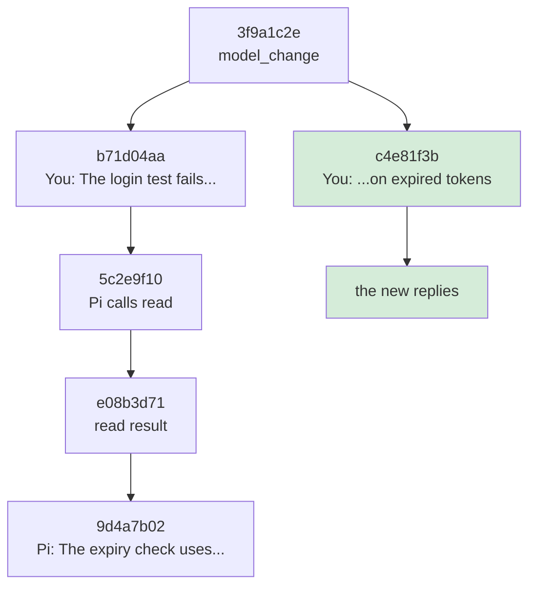
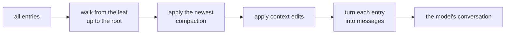

Close Pi in the middle of a task, run `pi --continue` the next day, and the conversation is still there. Go back three messages with `/tree`, try something else, and the first attempt is still there too. All of this lives in one plain text file per session.

This is the fifth post in my series about how the [Pi](https://pi.dev) coding agent works inside. [The compaction post]() said that a compaction is "one entry" in the session file, and that Pi rebuilds the conversation from the file before every request. This post opens that file. It answers one question: how does Pi save the history on disk, and how does it get the conversation back out?

As before, this post stays at a high level. The details, with pseudocode linked to the real code, are on [the session-manager reference page](/inside-pi/coding-agent/session-manager.html). Everything is pinned to commit [`195120a`](https://github.com/earendil-works/pi/tree/195120a9156b79b0fab67d3a458b5315bed7a33f). Almost all of it is in one file, `packages/coding-agent/src/core/session-manager.ts`.

## Where the file lives

Pi keeps one folder per project, under `~/.pi/agent/sessions/`. The folder name is the working directory with its slashes turned into dashes:

```
/Users/me/work/app   →   ~/.pi/agent/sessions/--Users-me-work-app--/
```

Each session is one file in that folder, named after the time it started and its id:

```
2026-11-21T09-30-00-000Z_019ab3f0-7c1e-7a2b-9d4e-5f6a7b8c9d0e.jsonl
```

The id is a UUIDv7, which starts with the time. So both the file name and the id sort by when the session was created. If you'd rather keep all sessions in one place, `--session-dir`, the `PI_CODING_AGENT_SESSION_DIR` variable, or the `sessionDir` setting change the folder.

The file is JSONL: one JSON object per line. The first line is a *header*. Every line after it is an *entry*.

## A session, line by line

Say you start Pi in `/Users/me/work/app`, pick a model with `/model`, and ask it to fix a failing test. Pi reads a file and answers. Here is the file afterwards, with the timestamps and most of the message content trimmed:

```
{"type":"session","version":3,"id":"019ab3f0-…","cwd":"/Users/me/work/app"}
{"type":"model_change","id":"3f9a1c2e","parentId":null,"provider":"anthropic","modelId":"claude-sonnet-4-5"}
{"type":"message","id":"b71d04aa","parentId":"3f9a1c2e","message":{"role":"user","content":"The login test fails. Find out why."}}
{"type":"message","id":"5c2e9f10","parentId":"b71d04aa","message":{"role":"assistant","content":[{"type":"toolCall","name":"read",…}]}}
{"type":"message","id":"e08b3d71","parentId":"5c2e9f10","message":{"role":"toolResult","toolName":"read",…}}
{"type":"message","id":"9d4a7b02","parentId":"e08b3d71","message":{"role":"assistant","content":[{"type":"text","text":"The expiry check uses <, not <=."}]}}
```

(I also left out the system message that records the prompt and the tools. That's the topic of the next post.)

Each entry has an `id`, 8 random hex characters, and a `parentId`, the id of the entry before it. The first entry has no parent. So far that just makes a chain. But it's the `parentId`, not the line order, that says what comes before what. That is what lets the file hold a tree, as we'll see in a moment.

Pi also keeps a pointer called the *leaf*: the entry the session is at right now. Every new entry gets the leaf as its parent, and then becomes the new leaf. All the `append` functions in the code work this way:

```
fn appendMessage(message):
    entry = { type: "message", id: new 8-character id, parentId: leaf, message }
    add entry to the file
    leaf = entry.id
```

Not everything is a message. These are the entry types, grouped by whether the model sees them:

| Model sees it | Entry types |
|---|---|
| Yes | `message` (system, user, assistant, tool result), `custom_message` from extensions, `compaction`, `branch_summary` |
| Changes what it sees | `context_edit`: hides or replaces an earlier entry |
| Sets the model | `model_change`, `thinking_level_change` |
| No | `custom` (extension state), `label` (a bookmark), `session_info` (the name from `/name`), `usage` |

### When lines get written

The `AgentSession` class listens to the agent's events. When a message is complete (a `message_end` event), it appends one entry. A reply that's still streaming is never written to the file. It's saved once, when it ends. Other entries come from elsewhere: `/model` adds a `model_change`, compaction adds a `compaction`, and so on.

There's one twist. In the example, `/model` came before your first message. At that point Pi doesn't create the file yet. It keeps the `model_change` in memory and waits:

```
fn persist(entry):
    if the file doesn't exist yet:
        if there's no user or assistant message yet:
            return                       // keep it in memory for now
        create the file (fail if it already exists)
        write the header and every entry so far
    else:
        append entry as one line
```

The code's reason: opening and closing Pi without chatting should leave no file behind. And it waits for your first *message*, not the first reply, so that your prompt is saved even if the first reply never arrives. After that, every entry is one append of one line.

## Why one line per entry

The file only grows. Pi never changes or deletes a line it wrote. Even a compaction doesn't remove the old messages. It adds a new entry that says where the summary ends, and the old lines stay.

Append-only makes the file hard to break. Saving an entry is a single append. If Pi crashes in the middle of one, the worst case is half a line at the end of the file. When Pi loads the file, it reads it line by line and skips any line that isn't valid JSON. Then, if the file doesn't end with a newline, it adds one, so the next entry starts on a line of its own. Everything before the broken line still loads.

A few more guards on loading:

- **The header must be first.** If the first record isn't a session header, Pi refuses to open the file and doesn't touch it. An empty file is the exception: Pi writes a fresh header into it.
- **Big files load in chunks.** Pi reads 1MB at a time, so a session bigger than JavaScript's largest string still opens.
- **Old files are migrated once.** Version 1 files were a flat list with no ids. Pi gives every entry an id and makes the entry before it its parent. The move to version 3 renamed one message role. After a migration, Pi rewrites the whole file one time. That's the only time it rewrites a file.

## Going back makes a branch

Now say you're not happy with the answer. You open `/tree`, which shows the session as a tree, and pick your first message, `b71d04aa`. You want to ask the question differently.

Pi doesn't delete anything. It moves the leaf to the *parent* of the message you picked, `3f9a1c2e`, and puts your old text back in the editor. You change it and press Enter. The new message gets the leaf as its parent:

```
{"type":"message","id":"c4e81f3b","parentId":"3f9a1c2e","message":{"role":"user","content":"The login test fails on expired tokens. Check the expiry check."}}
```

Now two entries have `3f9a1c2e` as their parent. The file is still a list of lines, appended in order, but the `parentId` fields make it a tree:



The green part is the *active branch*: the entries from the root to the leaf. The old branch is still in the file, and you can go back to it with `/tree` at any time.

If you pick an entry that isn't a message you typed, like Pi's reply `9d4a7b02`, the leaf moves to that entry itself. Your next message then continues from there.

Moving the leaf doesn't write anything. Only the next entry does. So if you move with `/tree` and quit before typing, the next time you open the session you're back at the last line of the file. When Pi loads a file, the leaf is simply the last entry written.

### Branch summaries

When you leave a branch with `/tree`, Pi can summarize it. The [compaction post](#branch-summaries-going-back-and-trying-again) covers how the summary is written. Here's how it's stored: as a `branch_summary` entry, with two pointers that are easy to mix up.

- `parentId` is where you moved *to*. The summary is the first entry of the new branch.
- `fromId` is where you came *from*: the old leaf.

Because the summary sits on the new branch, the model on that branch sees it. The old branch doesn't.

## From the tree back to a conversation

Before every request, Pi turns the file into the list of messages the model gets. Pi calls this the *projection*. The messages in a request always come from the entries, built again for each request:



**1. Walk the branch.** Start at the leaf, follow `parentId` up to the root, and reverse. In the example, that's `3f9a1c2e`, `c4e81f3b`, and the new replies. The old branch is never visited.

**2. Apply the newest compaction.** If there's a compaction on the branch, Pi keeps only the newest one. The compaction entry goes first. Then come the entries from its `firstKeptEntryId` up to the compaction, and then everything after it. Older entries are dropped. So are system messages from before the compaction, because the compaction saved a full copy of the system message at that point.

**3. Apply context edits.** A `context_edit` entry points at an earlier entry and either hides it (`replacement: null`) or replaces its content. Pi uses this, for example, to hide a reply that failed because the context was too long. The target entry itself never changes. If there are several edits for one entry, the latest one wins.

**4. Turn entries into messages.** A `message` entry becomes its message. A `compaction` becomes the saved system message plus a summary message. A `branch_summary` becomes a summary message. A `custom_message` becomes a message from an extension. Everything else (model changes, labels, extension state, usage) adds nothing.

Separately, Pi reads the model and the thinking level from the *whole* branch, including the part before a compaction. The last `model_change` or the last assistant reply on the branch decides the model.

Because the projection only looks at the active branch, edits are branch-relative too. Say you hide a message with a context edit, then use `/tree` to go back to a point above the edit. The edit is no longer on your branch, so the model sees the message again. Nothing had to be undone.

This is also why compaction is so cheap to add. A compaction doesn't touch the old entries. It's one more line, and the next projection simply starts from it.

## Fork and clone: a new file

`/tree` keeps everything in one file. Sometimes you want the other attempt as separate work, with its own file and its own entry in the session list. That's what `/fork` and `/clone` do:

| Command | What you get | Same file? |
|---|---|---|
| `/tree` | Move to any entry and continue from there | Yes |
| `/fork` | A new session that ends just before one of your messages. The message text goes back into the editor | No |
| `/clone` | A new session with the active branch, up to the leaf | No |
| `pi --fork <session>` | A new session with a full copy of another session, in the current folder | No |

`/fork` and `/clone` both use `createBranchedSession`. It copies one path, root to the chosen entry, into a new file:

1. Walk from the chosen entry up to the root, like the projection does.
2. Write a new header with a new id, and set `parentSession` to the old file's path. That's how the new session remembers where it came from.
3. Copy the entries on that path, with their ids unchanged. Entries on other branches are not copied.

The old file isn't changed at all. In the example, `/clone` at the leaf gives a new file with `3f9a1c2e`, `c4e81f3b`, and the new replies. The first attempt stays behind in the old file.

Labels need a bit of care. A label is an entry in the tree like any other, so later entries can be its children. If the copy just dropped the label entries, those children would point at a parent that isn't there. So Pi links each copied entry to the copied entry before it, and adds the labels back at the end as new entries.

`pi --fork` is different: it copies *every* entry, the whole tree, into a new file in the current project. Pi also offers it when you open a session that belongs to another folder.

## Opening a session again

How Pi picks a session when it starts:

- **`pi --continue`** opens the most recent session for this folder. "Most recent" means the file that changed last. Since every new entry is an append, that's the session you used last.
- **`pi --resume`** (or `/resume`) shows a list of sessions to choose from.
- **`pi --session <path or id>`** opens a specific one.
- **`pi --no-session`** keeps everything in memory. Nothing is written.

Opening a file reads it line by line, as described above, and then builds an index from id to entry. The leaf is the last entry in the file. From there, the next prompt is just another append.

## Go deeper

The [session-manager reference page](/inside-pi/coding-agent/session-manager.html) has the rest:

- every entry type and the `SessionManager` methods
- pseudocode for writing entries, loading and migrating a file, moving the leaf, building the projection, and forking, each linked to its line in the repo
- the rules the session file keeps, and examples taken from Pi's tests

It's part of the [Inside Pi reference site](/inside-pi/), next to the agent loop, the Agent wrapper, tools, and compaction.

Next, I'll look at what goes into a request: how Pi builds the system prompt from files like `AGENTS.md`, why skills load only when they're needed, and why the tool list lives in messages inside the conversation.
